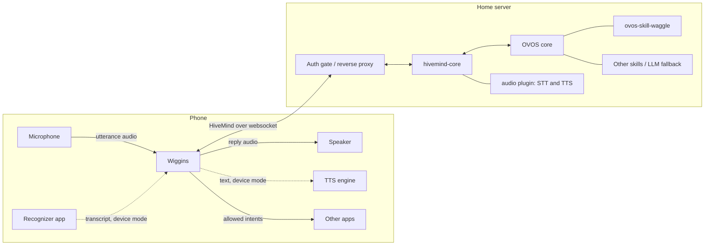

# Wiggins — HiveMind Android Client Spec

Oct 5, 2026 · Wiggins contributors

## Purpose and scope

Wiggins is an Android HiveMind client that registers as the system assistant, sends spoken requests to a HiveMind hub, speaks the replies, and launches Android intents the hub requests, within limits the user sets on the phone. It requires no Google services and is tested on GrapheneOS.

**Names.** The app is **Wiggins**, after the leader of the Baker Street Irregulars, Sherlock's errand-runners (OVOS descends from Mycroft, Sherlock's brother). The messages it uses for phone actions are the **Waggle protocol**, after the honeybee waggle dance. Waggle is defined in `ovos-skill-waggle/WAGGLE.md` and implemented on the hub by that skill.

Wiggins runs no speech models of its own. Speech-to-text and text-to-speech are each done either by the **hub** or by the **device**. With hub speech (M4), Wiggins records the utterance, the hub transcribes it, and the hub synthesizes the replies, the way a HiveMind voice relay works. With device speech, Wiggins uses apps the user already has, through standard Android intents and services. Hub speech is the main mode, because on-device recognizers and voices are usually much worse than what a hub can run. Device speech is the fallback for a hub without speech services.

Out of scope for v1: on-device wake word, on-device intent parsing, bundled STT or TTS models, streaming the microphone to the hub (for hub-side wake word), and reading or controlling the screen.

Out of scope altogether: actions the phone didn't ask for, such as another satellite or a home automation sending the phone a command. Wiggins acts only on requests made through it (decided 2026-10-12, which dropped the push wake-up milestone).

## Prerequisites

| Need | Why | Example on GrapheneOS |
| --- | --- | --- |
| A HiveMind hub (OVOS + hivemind-core) | Understanding and replies | — |
| For hub speech: the hub's `hivemind-audio-binary-protocol` plugin, with STT and TTS plugins configured | Speech-to-text and speaking replies (M4) | Plugins calling Wyoming Whisper and Piper servers |
| For device speech: a speech recognizer that handles `RecognizerIntent.ACTION_RECOGNIZE_SPEECH` | Speech-to-text | FUTO Voice Input (source-available, not OSI open source; Wiggins doesn't depend on it) |
| For device speech: a system TTS engine | Speaking replies | RHVoice, Sherpa TTS |
| Optional: ovos-skill-waggle on the hub | Phone actions (M5) | — |
| A HiveMind client key for this phone | Bus access | — |

Text input works with no speech set up at all, and replies are always shown as text, so Wiggins is usable before speech is set up. The setup screen checks for each prerequisite the chosen speech modes need and links to what's missing.

## Architecture

With hub speech, the phone records an utterance and sends it through the auth gate to hivemind-core, whose audio plugin transcribes it. The phone then sends the text as the question. OVOS routes it to a skill or the LLM fallback, and the hub sends back replies, which the audio plugin synthesizes, and Waggle requests, which the phone runs only as far as its allowlist permits. With device speech, the dotted paths replace the hub's STT and TTS.

## Stack

- **Language and UI:** Kotlin with coroutines and Jetpack Compose.
- **Network:** OkHttp for the websocket and mTLS; AppAuth (Apache-2.0, no Play Services) for the proxy sign-in.
- **Serialization:** kotlinx.serialization for all HiveMind and Waggle JSON; no second JSON library.
- **Storage:** Room for allowlist rules and the action log; DataStore for settings.
- **Secrets:** DataStore values encrypted with Tink under a master key held in Android Keystore. Not `androidx.security:security-crypto`, which is deprecated.
- **Crypto:** the HiveMind handshake and payload encryption use the platform JCA provider (Conscrypt). BouncyCastle is added only if the targeted hivemind-core needs a primitive the platform lacks: the Noise handshake uses its argon2id, which the platform lacks, and its raw X25519.
- **Dependencies:** open source only, with no Google Play Services, Firebase or other proprietary libraries, and a reproducible build, so F-Droid stays an option.
- **Build:** Gradle Kotlin DSL with a version catalog.
- **API level:** minSdk 34. Any feature that needs a later API level is noted where it's specified, and is disabled on older versions rather than raising minSdk.

## Connection

- **Transport:** HiveMind over websocket, not the HTTP protocol plugin. The hub URL may be `ws://` or `wss://`. HiveMind encrypts payloads end to end either way, so `ws://` is allowed in the "none" auth mode (LAN or VPN, such as Tailscale); the mTLS and proxy-login modes require `wss://`. Waggle needs the hub to push requests, and the connection only lives while the app is in use, so a websocket's drawbacks don't apply.
- **Protocol:** the HiveMind handshake, payload encryption and message framing are implemented in Kotlin; there is no JVM HiveMind client to reuse. Target the current hivemind-core release and test against vectors generated with the Python client.
- **Handshake:** the password handshake whenever the hub offers it, and the Noise handshake (protocol v3, `Noise_XXpsk2_25519_ChaChaPoly_SHA256`) when the hub offers only that, as hivemind-core 5 does. hivemind-core 4.7–4.15 offer both but can't send a message over 64 KB over Noise, which would break hub speech, so they get the password handshake. A switch on the Hub messages screen forces Noise for testing. The Noise PSK is stretched from the password with argon2id, salted with the hub's node id, and stored encrypted; it's stretched in the background after a password-handshake connection, so a hub moving to 5.x causes no wait. The phone's static key is stored encrypted too and isn't backed up, so after a reinstall the hub needs `hivemind-core reset-noise-pin`. Details: `docs/hivemind-protocol.md` §16.
- **Lifecycle:** connect when the assistant UI or main screen opens, stay connected while it's visible and while any Waggle request is pending, then disconnect after a short idle period. Ping on an interval to keep proxies from dropping the connection; reconnect on resume.
- **Session context:** each utterance carries an OVOS session with the phone's language and timezone, so ordinary skills (time, date) answer for the phone's location. The timezone goes inside the location the hub hands back, since a sent location replaces the hub's whole one and the phone has no city or coordinates to offer (the weather skill needs them). Until the hub has handed a session back, Wiggins sends no location and the hub's applies, timezone included. Waggle timestamps are UTC on the wire.

## Voice pipeline

Understanding always happens on the hub. Speech-to-text and text-to-speech each have a setting, **Hub** or **Device** (see "Speech modes").

1. **Trigger:** Wiggins holds the Android assistant role, so the assist gesture or long-press opens its assistant panel (see "Conversation screen"). A text box is always available. It qualifies through an exported `ACTION_ASSIST` activity, as Dicio does, not a `VoiceInteractionService`, so it never registers a recognition service or changes the system's default recognizer. The role can't be requested from inside the app, so the setup screen opens the system's assistant settings. An assist invocation starts listening at once, except from a keyboard shortcut. The same activity answers `ACTION_VOICE_COMMAND`, which Android sends for a headset's or car's voice button (the user picks Wiggins in a chooser the first time). On a locked phone either one asks for the unlock first (see "Lock screen" under "Conversation screen"), unless the user's "When the phone is locked" setting lets a car's or headset's voice button run a locked session (see "Permissions").
2. **Speech to text:** with hub STT, Wiggins records the utterance itself and the hub transcribes it (see "Hub speech-to-text"). With device STT, Wiggins starts `RecognizerIntent.ACTION_RECOGNIZE_SPEECH`, and the user's recognizer appears in the foreground and returns the transcript. Either way, Wiggins sends `recognizer_loop:record_begin` and `record_end` around listening.
   - **Listening tone:** just before it listens, Wiggins can play a short two-note chime on the route its speech plays on, so the user knows when to speak without looking. The setting is Never, Bluetooth (the default: only when speech would play on a car, headset or earbuds) or Always. It plays for follow-ups too. In a car the route is still the media one; moving the tone and the recording to the hands-free link is the car work in the backlog.
3. **Uplink:** the transcript is shown as the user's bubble and goes to the hub as a `recognizer_loop:utterance` message.
4. **Reply:** the hub's `speak` messages (`ovos.utterance.speak` from ovos-core 3, which may send a sentence under both names; Wiggins drops the copy) are shown as text and read aloud, by the hub's TTS (see "Hub text-to-speech") or by Android `TextToSpeech` with the system engine. While a reply is being read, the mic button becomes a stop button. A speaker toggle in the app bar and panel turns spoken replies off (text only) until turned back on, and is remembered. With speech off, a follow-up question starts listening straight away. The volume keys control the voice's volume on Wiggins' screens.
   - **Telling the hub:** as a voice satellite's audio service does, Wiggins sends `recognizer_loop:audio_output_start` when it starts reading a reply and `recognizer_loop:audio_output_end` once everything queued has played or been stopped, with the conversation's session. A skill that speaks with `wait=True` (the alerts skill does) waits for that end, up to 15 s, before it finishes, so the turn's `ovos.utterance.handled` comes after it. When a `speak` plays nothing (speech off, no TTS engine, no words), Wiggins sends an end for it straight away, without a start, so no skill waits out the 15 s.
5. **Follow-ups:** when a `speak` message expects a response, or the hub sends `mycroft.mic.listen` (or `ovos.mic.listen`), Wiggins listens again after speech finishes.

### In the car

A car's or headset's voice button sends Android the Bluetooth hands-free "start voice recognition" command, and Android opens Wiggins with `ACTION_VOICE_COMMAND`. A car in that mode mutes media and expects the assistant on the hands-free channel (SCO), both ways, and Android gives up on the session after a few seconds unless the app takes it up. So with **Car and headset** on (Settings → Speech; off by default, and turning it on asks for Android's "Nearby devices" permission, `BLUETOOTH_CONNECT`):

- Before listening, if a hands-free device is connected, Wiggins starts a Bluetooth voice-recognition session (`BluetoothHeadset.startVoiceRecognition`). That takes up a session the car started, or starts one, and opens the hands-free audio. Wiggins waits up to 4 s for it, then makes it the communication device.
- While it's up, the listening tone plays on it, then Wiggins records from its microphone. Hub speech plays on it (voice-communication usage, with the link as the preferred device), and so does the phone's TTS engine (voice-communication attributes).
- It stays up through the turn (listening, waiting for the hub, speaking) and closes 3 s after the turn goes quiet, so a follow-up question keeps it. Closing ends the voice-recognition session, and the car gets its media back.
- With no hands-free device, no permission, or a link that doesn't come up, speech stays on its usual route.

Released in 0.5.0 (built 2026-10-12) and unit-tested against Robolectric's Bluetooth headset. On 2026-10-13 it was checked on the emulator against a virtual hands-free unit (`tools/car/`). A press launched Wiggins, which took up the session and opened the SCO link, and an assist invocation sent the car `+BVRA:1`. The emulator's SCO link carries only silence, so audio is untested. Not yet tried in a car or with a headset.

To answer within Android's few seconds, Wiggins opens the link as soon as listening starts, before its panel is on screen, and only records once it is.

### Permissions

Decided 2026-10-14 (0.7.0). The hub sets the most each client may do; Wiggins narrows it, per **context** and, from 0.7.x, per persona tool. The phone decides which context it's in, and tells the hub with every message.

**Contexts**, checked on every message:
- **Unlocked:** the keyguard isn't locked.
- **Trusted device:** the phone is locked, the session came from a trusted car's or headset's voice button (`ACTION_VOICE_COMMAND`; the assist gesture never runs locked), every connected hands-free device is trusted, and the call audio goes to one of them. Android doesn't say which device pressed the button, so any untrusted hands-free device connected makes it a locked session or an unlock prompt. An untrusted device connecting mid-session, or the audio leaving the trusted devices, turns it into a locked one from then on.
- **Locked:** anything else running locked: another headset when the user allows "Talk only", and later a hotword while charging (the nightstand).

A phone in a car mount is usually locked, and asking for the unlock there defeats the steering-wheel button: Android gives up on the car's session after about 5 s, and the car reports an error. Extend Unlock (Smart Lock's trusted devices) is Google Play services' trust agent, which needs a signature|privileged permission, so it isn't available on GrapheneOS; hence Wiggins' own trusted devices.

**Settings** (Settings → Speech, shown with **Car and headset** on):
- **Trusted devices:** the user ticks paired devices. A trusted car and trusted earbuds both connected still count as trusted.
- **Unlock once per drive** (off by default): a trusted device works locked only after the phone was unlocked while it was connected, until it disconnects. Wiggins counts an unlock it sees itself (its unlock prompt succeeding, a Wiggins screen on the unlocked phone, or the device connecting while unlocked), never Android's unlock broadcast, which can arrive late. A manifest receiver disarms a device as soon as it disconnects; runtime receivers aren't used, since Android holds their broadcasts back while an app is cached. The armed set lives in memory only, which errs towards asking.
- **Other headsets:** Ask to unlock (the default), or Talk only, which runs as Locked.
- **Where phone actions run** (Phone actions screen): Unlocked and Trusted device on, Locked off, by default. Where they're off, every Waggle intent and query is answered `blocked`. Rules read **Allow / Ask me / Never** (`run` / `ask` / `block` on the wire). Ask me shows an ask card, so it runs only unlocked: elsewhere it's answered `blocked`, with no card. Nobody taps confirmations in a car.
- Before 0.7.0 the setting was "When the phone is locked". Its migration trusts nothing new: Trusted car keeps its devices with unlock once per drive on; Always becomes Talk only; devices ticked under Ask to unlock are dropped.

**Every uplink's message context** (`docs/hivemind-protocol.md` §11.1), always present:
- `phone_context`: `unlocked`, `trusted_device` or `locked`;
- `device_locked`: true unless unlocked, so a hub without the newer keys withholds personal tools whenever the phone is locked;
- `can_ask`: true only when unlocked, so Waggle treats ask rules as block elsewhere and never says "Confirm on your phone";
- `phone_actions`: whether phone actions run here, so Waggle steps aside where they don't;
- `persona_history`: `full`, or `since_lock` when locked; the hub may narrow it, never widen it;
- `persona_tools`: the persona tools the user allows here: per server `"none"` or a list of tool names. Servers the user hasn't changed are left out, so the hub's defaults for the context apply to them.

A **locked session** (trusted device or locked):
- shows a small panel over the lock screen (Listening…, Thinking…, Speaking…, with Unlock and End). It holds nothing from the conversation, wakes the screen and keeps it on until the session ends;
- listens and speaks only through the hands-free link. If the link doesn't come up, it falls back to the unlock prompt. It needs hub speech-to-text, since the user's recognizer can't show over the lock screen;
- runs phone actions only as above. Apps that open a screen (the dialer, a text, an app) open behind the lock screen, so in practice what works locked is what needs no screen: timers, alarms, snoozing, and the queries;
- ends when the link closes, 3 s after the turn goes quiet. Unlock turns it into an ordinary panel with the conversation so far.

**Persona tools** (0.7.1, Permissions screen: the overflow menu, or Phone actions): after each connection Wiggins sends `ovos.persona.list`, and the hub answers with its persona's tools for this phone: per server, each tool's label, a short description, whether it's destructive, what the hub allows per context at most, and its default there (`docs/hivemind-protocol.md` §12.2). Wiggins keeps the latest answer; a hub that doesn't answer leaves the section saying the hub decides.
- A tab per context holds its phone-actions switch, how much of the conversation the persona sees (a choice only for a trusted device: everything, or since locking; unlocked is everything, locked since the lock), and the tools: per service All, None or Mixed, opening to a switch per tool, with a reset to the hub's defaults.
- A tool the hub doesn't allow in a context shows, switched off, with "Not allowed here by the hub". Destructive tools (⚠) are off by default everywhere, whatever the hub's default, until the user turns them on; turning a whole service on leaves them as they were.
- A service the user changes is sent as the exact list of tools that are on, never `"all"`, so a tool the hub adds later, a delete included, starts off there. A service the user hasn't changed follows the hub's defaults.

Later, designed for now: a voice readback with a spoken yes or no in place of the ask card where there's no screen (`ask_methods` in the context).

### Speech modes

- **Settings:** speech-to-text and text-to-speech each have a Hub or Device setting, so a user can mix them, for example hub STT with a favourite on-device voice. Hub STT has an **Early transcription** switch, on by default (see "Hub speech-to-text").
- **Default:** the setup screen checks hub speech by asking the hub to synthesize a short phrase. The plugin can't load without both an STT and a TTS engine, so an answer means both are available. If the hub answers, both settings default to Hub. If it doesn't, they default to Device, and the setup screen says the hub has no speech services. An install upgraded from before M4 runs the check once, on its next connection.
- **Messages:** hub speech uses the JSON messages of HiveMind's `hivemind-audio-binary-protocol` plugin, the same ones `hivemind-voice-relay` uses. They are ordinary `bus` messages, so they need no binary frames (binarize stays off), and they travel over the same encrypted, authenticated connection as everything else. No speech service is exposed beyond the hub.
- **Session:** speech requests carry the conversation's session like any other message, and its language as `lang`.

### Hub speech-to-text

1. **Recording:** Wiggins records from the microphone with `AudioRecord` (source `VOICE_RECOGNITION`, 16 kHz, mono, 16-bit PCM) and takes transient audio focus, so music pauses or ducks. The listening indicator makes the state plain at a glance (decided 2026-10-14):
   - **Getting ready:** from the tap until the microphone opens (the hands-free link, the tone), the mic button carries a spinner and the text box says "Getting ready…".
   - **Listening:** the button turns into a filled stop square in the recording colour. A ring breathes out from it all the time, even in silence, and a halo grows with the input level. The text box shows a five-bar level meter beside "Listening…". A short haptic tick marks the moment the microphone opens.
   - **Stopping:** tapping the button ends the utterance early.
   - **Locked panel:** shows the same meter. Cancel, Back or closing the panel discards it.
2. **End of speech:** a voice activity detector on the phone ends the utterance after about 0.8 s of silence following at least 0.2 s of speech. If no speech starts within 8 s, Wiggins stops and sends nothing. An utterance is capped at 30 s, which keeps each message under about 2 MB on the wire. Tuning is a constant in code, not a setting.
3. **Transcription:** Wiggins sends `recognizer_loop:b64_transcribe` with `{"audio": <base64 raw PCM>, "lang": ..., "sample_rate": 16000, "sample_width": 2}`, and puts a random `wiggins_id` in the message's context. The user's bubble shows "Transcribing…" until the hub answers with `recognizer_loop:b64_transcribe.response`, whose `transcriptions` is a list of `[text, confidence]` pairs. The response's data doesn't echo the request's, but the hub builds it with `Message.reply`, which copies the request's context, so Wiggins matches it by `wiggins_id` and ignores any response for a request it no longer wants. Wiggins takes the first transcription, trims it, and sends it as the utterance (pipeline step 3).
4. **Early transcription:** waiting for 0.8 s of silence and then transcribing (about 0.5 s on a CPU hub) adds the two delays together. With the switch on, Wiggins overlaps them: after 0.3 s of silence it sends the audio so far for transcription, without ending the recording. If the silence reaches 0.8 s, the utterance ends and that transcription is the result, usually already back. If speech resumes first, Wiggins discards that request's response, and repeats the step at the next pause with the longer audio. A new early request replaces any outstanding one, whose response is then ignored, so a quick pause after resumed speech never waits on stale audio. The cost is a wasted hub transcription for each mid-sentence pause. With the switch off, Wiggins transcribes only once the utterance has ended. The switch exists in case early transcription doesn't pay off in use; if it does, the switch may be removed later.
5. **Failures:** an empty transcription removes the pending bubble and shows "Didn't catch that". No answer within 15 s does the same and shows a status banner that hub speech isn't answering, with an action to switch to device speech.

Wiggins transcribes first and then sends the text, rather than sending `recognizer_loop:b64_audio` (which the hub transcribes and handles in one step). That way the user's words appear before the answer, the client's default permissions suffice, and both modes send the hub the same message.

The audio is raw 16 kHz mono 16-bit little-endian PCM, with no WAV header, which hivemind-audio-binary-protocol 2.2 expects. It checks the two sample fields and wraps the bytes as they are. Checked 2026-10-12 against the hub's own listener image (plugin 2.2.2a1 with its hivemind-core 4.15 overlay) and a stand-in STT server: headerless audio reached the server byte for byte, while the WAV Wiggins sent before arrived with its 44-byte header inside the audio, about 1 ms of noise. Plugin 2.1.x read the data as an audio file and needs the header, so Wiggins now needs a hub on 2.2 or later for hub speech-to-text.

### Hub text-to-speech

1. **Request:** Wiggins splits each `speak` it will read aloud into sentences, since one `speak` can be a whole paragraph that a CPU engine takes over 10 s to synthesize. For each sentence it sends `speak:b64_audio` with `{"utterance": ..., "lang": ..., "wiggins_id": <random id>}`. It requests the next sentence's audio while the current one plays, so a multi-sentence answer has no gaps. Sentences always play in the order their `speak` messages arrived, whatever order the audio comes back in.
2. **Response:** the hub replies with `speak:b64_audio.response`, whose data is the request's data plus `audio`, a base64 WAV file. Wiggins matches it to the request by `wiggins_id`, and plays the sentences in the order the `speak` messages arrived.
3. **Playback:** the WAV's PCM goes to an `AudioTrack` with assistant usage, at whatever rate and format the hub's engine produced (for example 22050 Hz, 16-bit mono for Piper). Stop, the speaker toggle and the volume keys behave as with the device engine. Wiggins takes transient audio focus while speaking.
4. **Failures:** if the audio for a sentence doesn't arrive within 10 s (plus 40 ms for each character past the first 100, for a long sentence), Wiggins speaks it with the device engine when one is installed, otherwise leaves it as text only, and shows the same status banner as for STT.

## Conversation screen

- **Assistant panel:** the assist gesture opens a panel anchored to the bottom of the screen, over whatever app is open, like other assistants, not the full app. It starts with a fresh conversation on screen that lasts only while the panel is open and isn't added to the saved one. The hub's side of the conversation (OVOS session state, a persona's chat history) is shared with the app. The panel listens straight away, as the full app did. Until its first bubble, the panel's conversation area shows Wiggins as a big listening indicator instead of suggestions (decided 2026-10-14): resting while idle, blowing bubbles while connecting, a stroke running round his frame while listening gets ready, and while listening a honeycomb ring breathing out from him and a honeycomb halo growing with the input level, in his amber, with the text under him saying which. The first bubble, usually the user's "Transcribing…", fades in as he fades out, and the area keeps his height, so the text box doesn't move. The app's empty screen keeps its suggestions. Tapping outside it, Back, or leaving it closes it and stops any speech. A button opens the full app, which the launcher also opens, with the saved conversation.
- **Lock screen:** the panel doesn't show over the lock screen; it would sit hidden behind it and couldn't listen. So when it's invoked on a locked phone (the assist gesture, or a car's or headset's voice button), Wiggins asks Android for the unlock prompt and listens once the phone is unlocked. That covers the most common moment to say "snooze": with an alarm ringing, the user unlocks with a fingerprint and speaks, and the Clock snoozes it. If the user backs out, a hint ("Unlock to talk to Wiggins", with Unlock and Close) shows over the lock screen for 5 s, holding nothing from the conversation, then the panel closes and whatever it covered, such as the ringing alarm's screen, comes back. A toast can't carry the hint: Android drops toasts from an app whose notifications are off. A car's or headset's voice button can run a locked session instead, if the user allows it (see "Permissions"). A fuller lock-screen mode, where the panel works over the lock screen for a few safe actions, is in the backlog.
- **Watching:** a question asked from the panel or the app, on an unlocked phone and not over a car's or headset's hands-free link, is sent with `user_watching: true` in its message context; any other uplink is sent with false (`docs/hivemind-protocol.md` §11.1). With true, the hub doesn't speak a confirmation whose result is on screen: alarms shown, an app opened, the dialer, a drafted text. Nor does it speak "Confirm on your phone." for an ask card the user can see (WAGGLE.md "Watching"). Questions, failures and background actions (setting a timer or alarm, stopping, dismissing, snoozing) are still spoken. A muted turn has no reply bubble; it ends on `ovos.utterance.handled` like any other. Decided 2026-10-14.
- **One answer, one bubble:** OVOS may speak an answer a sentence at a time (a persona streaming from an LLM does). Each sentence is spoken as it arrives, and the sentences of one answer join into one bubble, which shows small rising bubbles while more may come. It's complete when the hub reports the question handled (`ovos.utterance.handled`), when a sentence asks a follow-up question, when the connection drops, or after 15 seconds without a new sentence. Speech the hub starts by itself, such as a timer going off, is a bubble of its own.
- **The conversation is what the hub remembers:** the user's utterances and the hub's replies, in one OVOS session. OVOS keeps conversation memory on the hub keyed by `session_id` (a persona's chat history, active skills), so the screen and that memory begin and end together. The session id is saved with the conversation, so an app restart continues it, and OVOS's session state is carried across reconnects. The conversation ends, clearing the screen and starting a new session (and so a new connection), when the user clears it or after 30 minutes without a question or reply: the hub can't be asked whether it still remembers a session, so idle time is the best guess at when it's stale.
- **Status is not conversation.** Connection and setup problems (not configured, wrong password, can't reach the hub, assistant role not held) are shown as status: the connection state under the title, and at most one banner naming the current problem with an action to fix it. Status reflects the current state, so it disappears when the problem is fixed, and navigating, reopening or reconnecting never adds duplicates.
- **A question that couldn't be sent** is marked on its own bubble ("Not sent", with retry) rather than as a separate error entry.
- **An answer lost to a dropped connection** (0.8.0): the hub answers on the connection a question came on, never on a new one. If the connection goes while a question waits and none of its answer has come, the bubble says "No answer: the connection changed", with Ask again. It isn't re-sent by itself, since the hub may already have acted on it; a turn in which the phone already ran a Waggle request isn't offered again at all. Reconnects Wiggins chooses (the Noise switch, saving settings, a new session) wait for the turn to end, or for the 30 s thinking timeout.
- **The text box stays at the bottom** of the app, from an empty conversation on, with a short conversation sitting just above it, as in a chat app. (0.5.3 let it ride up under a short conversation; fixed in 0.6.0.) The conversation stays at its newest message when the keyboard opens or closes and as replies arrive, unless the user has scrolled up to read; then it stays where they are (0.6.1).
- **Exact words for the persona** (Settings → Persona, on by default, 0.6.1): every uplink carries `persona_raw_utterance`, asking the hub to give its persona the question exactly as said or typed rather than the normalized text skills match on (`docs/hivemind-protocol.md` §11.1).
- **Reply details** (decided 2026-10-14, 0.6.0): long-pressing a bubble, the question or any part of its reply, opens a sheet with what's known about that turn. There's no setting for it: it stays out of the way until asked for. It's kept with the conversation, so it survives a restart; bubbles from before 0.6.0 say nothing was kept.
  - **What answered:** from `ovos.intent.matched`, the skill (or the persona, by the name the hub gives it), the pipeline stage, the intent and its slots; from each sentence's `meta`, the dialog and its values; the Waggle requests the phone handled and their outcome; whether a follow-up question was asked; "None was spoken" for a quiet turn (see "Watching").
  - **Timeline:** a waterfall, like a browser's network panel. Each phase is a bar on a shared time axis from the start of listening (or the question, if typed), coloured by who did the work (phone, hub, persona, tools, speech), with its duration beside it; tapping a row shows its numbers. The phone measures listening, the hub's transcription, any wait for the connection, sending to the match, each phone action (with an ask card's wait, lighter), each sentence from arrival through its audio to the end of playback (waiting lighter), and the end of the turn.
  - **The persona's report:** a hub may send `persona.turn.debug` before the end of a persona's turn (`docs/hivemind-protocol.md` §12.1), with its model requests (time to first text, tokens, stop reason) and the tools it called. Those rows are placed by the hub's clock, anchored so that the report's `sent_ms` falls when it arrived, and marked ≈: approximate, to within the network delay. Every field is optional, and nothing assumes which model or persona a hub runs.
  - **Usage:** the persona's token counts summed over its requests (input, cache read, cache write, output, thinking: whichever the hub reports), and an estimated cost if the hub gives one, labelled as the hub's estimate. Each request's own counts are in its row's numbers.
  - **Copy text** (0.6.1) copies the pressed bubble's words; **Copy details** copies a plain-text account of the turn.
  - **Not known:** a phase that didn't happen has no row; one the hub didn't report says "Not reported by the hub"; the phone's own bars show either way. Nothing shown comes from the app's code or the hub's address, only what the hub sent about the turn.

## Stock OVOS skills

Until M5, Wiggins is a plain HiveMind client: it sends utterances and handles `speak`, the follow-up messages above and, from M4, the hub speech replies. Stock skills should work as they do through any text satellite. Things to find out during M1–M3:

- **Other downlink messages:** which message types stock skills send to a satellite beyond `speak`, such as sound effects, media playback (OCP) and GUI messages. M1 logs them all; each one is then handled, ignored on purpose, or added to the spec.
- **Timers and alarms:** the stock timer and alarm skills run on the hub, so their alerts play there. Decided 2026-10-06: a request spoken to the phone is meant for the phone. ovos-skill-waggle's pipeline stage takes it ahead of the alerts skill, but only for a client that has announced `waggle.capabilities`, so other satellites keep the hub's timers (`ovos-skill-waggle/SPEC.md` "The pipeline stage").

## Phone actions (Waggle)

Waggle arrives in M5.

The full protocol, including message formats, error codes and query schemas, is in `ovos-skill-waggle/WAGGLE.md`. In short: the hub sends `waggle.intent` to launch an activity and `waggle.query` to read data; the phone answers each with a response carrying the request `id`, and announces its rules and enabled queries in `waggle.capabilities` on connect and whenever settings change. This section covers what's specific to Wiggins.

**Allowlist.** Each rule matches on action and optionally on data scheme, package and category, and says run, ask or block. The most specific matching rule wins and ties go to the stricter mode. An intent no rule matches follows the **unmatched intents** setting: block (the default) or ask. Ask lets new skill actions work, with a confirmation each time, while the phone's rules catch up with the hub. Rules and the setting are edited only on the phone, never from the hub. Wiggins ships with these defaults:

| Rule | Mode |
| --- | --- |
| `SET_ALARM`, `SET_TIMER`, `SHOW_ALARMS` | run |
| `SHOW_TIMERS`, `DISMISS_TIMER`, `SNOOZE_ALARM` | run |
| `DISMISS_ALARM` | ask |
| `MAIN` + `LAUNCHER` (opening apps) | run |
| `DIAL` with `tel:` | ask |
| `SENDTO` with `smsto:` / `sms:` | ask |
| Anything unmatched | block, or ask if the user enables it |

The ask card for an unmatched intent offers "Allow always", which creates a rule from it, so a drifted action needs confirming once rather than forever. The launch rules below apply whatever the mode.

Defaults reach existing installs through the rules database's migrations: each version's new defaults are added only for actions the user has no rule for, so their own rules are never overridden. Database version 2 (0.4.0-rc3) added the four Clock actions above. Stopping ringing timers, showing timers and snoozing touch only what's ringing or open the Clock, so they run. Dismissing an alarm can cost a wake-up, so it asks. On the stock Clock (AOSP DeskClock) these intents report nothing back, so a successful response means only that the Clock accepted the launch. `DISMISS_TIMER` affects only ringing timers (there's no intent that cancels a running one), and the Clock only dismisses alarms due within 24 hours. Its intent handler is single-instance: a second Clock intent that arrives while the first is still starting (seen with a cold Clock and two requests 0.2 s apart) never runs, though Wiggins still answers `ok`, so a hub should leave about a second between consecutive Clock requests.

**Launching.**

- Intents launch with `startActivity`. The response reports whether the launch succeeded, not what the target app did.
- Wiggins never adds hub-supplied flags and never grants URI permissions. It rejects `content:`, `file:`, `intent:` and `android-app:` URIs in `data` and in `uri` extras, and any intent that would resolve to Wiggins itself.
- Android limits activity launches from the background, and drops a refused launch without an error. With the connection tied to the UI, Wiggins is normally in the foreground when requests arrive; when no Wiggins screen is visible it doesn't try, and answers `launch_failed`.
- `ACTION_CALL` (and its privileged and emergency variants) is never supported: it answers `blocked`, whatever the rules say, so Wiggins never holds `CALL_PHONE`.
- Android only lets Wiggins see apps its manifest's `<queries>` names, so the targets of the default rules are listed there. An intent for anything else can still launch, but Wiggins can't tell in advance whether an app handles it, and may answer `no_handler`.
- Opening an app by package (`MAIN` + `LAUNCHER` + `package`) targets that app's launcher activity directly, since launcher activities usually don't accept implicit intents.

**Asking.** For an "ask" rule, Wiggins shows a confirmation card with the hub's `description` and, beneath it, the raw action, URI and target, so a hub can't disguise what it asks for. For the Clock's show, dismiss and snooze intents the card also says in words what the extras ask for (for example "Dismisses the alarm at 6:30 AM", or "Dismisses ALL your alarms"), read the way the stock Clock reads them. If the user doesn't answer within `ask_timeout_s` (default 15 s, announced in capabilities), it answers `timeout`. Wiggins stays connected until the card is resolved.

**Queries.** `calendar.next`, `contacts.lookup` and `apps.list` are implemented in the client. Each is off until the user enables it, which is also when Wiggins requests the matching permission. `apps.list` uses a `<queries>` entry for launcher activities, so no `QUERY_ALL_PACKAGES` permission is needed.

**Action log.** Every Waggle request is logged on the phone: time, request, the matching rule and the outcome. The log keeps the latest 500 and stays on the phone; it can be cleared.

**Where it lives.** Rules, the unmatched setting and the queries are on the Phone actions screen (the app's overflow menu), with the action log beside it. Wiggins announces `waggle.capabilities` after each connection's handshake and again whenever any of them changes. The ask card appears above the text box, in the app or the assistant panel, and a pending one keeps the connection open.

## Security requirements

Two independent layers: the network path is gated by the user's choice of auth mode, and the bus is gated by a HiveMind key with narrow permissions.

- **Auth modes (pluggable):** none (LAN or VPN), client certificate (mTLS at the reverse proxy), or sign-in, where the proxy checks an identity-provider access token. Client certificates come from Android KeyChain, either chosen there or imported from a PKCS#12 file through the system installer.
- **Sign-in (M3):** the supported example deployment is Pomerium running as a Kubernetes ingress controller (it terminates TLS for the hub's host), with Entra ID as the identity provider. Any proxy that validates an identity-provider access token on the websocket upgrade fits the same mode. Wiggins is an OAuth public client of Entra: AppAuth runs the authorization-code flow with PKCE in a browser tab, with the redirect `com.mulesipstea.wiggins://oauth2redirect`, and requests the hub API's scope plus `offline_access`, so it refreshes silently. It sends `Authorization: Bearer <access token>` on the websocket upgrade. Pomerium validates the token (`bearer_token_format: idp_access_token`, with the API as the allowed audience) and applies the route's app role (for example `hivemind.access`), then strips the header before the hub. The issuer URL, client ID and scope are settings. Policy is checked on the upgrade only, so an open connection outlives its token; the next connect refreshes it. A 401 or a redirect asks the user to sign in again, and a 403 means the account lacks the role. Pomerium's own programmatic login was rejected: it only redirects to allowlisted http(s) hosts, needs signing in again every 14 hours, and its token opens every route the user can reach. Details: `docs/m3-pomerium-auth.md`.
- **Client certificates at Pomerium:** deferred (2026-10-04) until a client that can't sign in in a browser needs remote access, such as a satellite at another site. Wiggins already supports the mode. Enabling it means a global client CA on the Pomerium CR with `enforcement: policy` (never the default `policy_with_default_deny`, which would lock certificate-less clients out of every route), plus a route policy of "role OR pinned SPKI hash". Every Pomerium host then asks for a client certificate during the handshake, so Android browsers may show a certificate picker. Details: `docs/m3-pomerium-auth.md` §5.
- **Secrets:** HiveMind credentials and tokens stored in Tink-encrypted DataStore under a Keystore-held key (see Stack).
- **Hub-side permissions:** a dedicated non-admin HiveMind client allowed to send only `recognizer_loop:utterance`, `recognizer_loop:record_begin`, `recognizer_loop:record_end`, `recognizer_loop:audio_output_start` and `recognizer_loop:audio_output_end`. Hub speech (M4) adds `recognizer_loop:b64_transcribe` and `speak:b64_audio`. All seven are in the default `allowed_types` of hivemind-core 3.4 (stable), but newer HiveMind grants nothing by default, so set them with `hivemind-core allow-msg`. M5 adds `waggle.capabilities`, `waggle.intent.response` and `waggle.query.response`, and 0.7.1 `ovos.persona.list` (the persona's tool catalog; without it the hub's defaults apply).
- **Locked sessions:** off by default. When the user allows them, they run only over a car's or headset's hands-free link, show nothing from the conversation, run only the phone actions the user allows there (never an ask), and tell the hub where the phone is with every message, so it can withhold personal tools (see "Permissions").
- **Speech audio:** with hub STT, Wiggins records only while the listening indicator shows, keeps no recordings, and sends audio only to the hub, inside the encrypted HiveMind connection. The hub passes it to its STT service, which the hub's operator chooses.
- **Phone-side permissions:** commands from the hub are untrusted. Intents run only as the allowlist permits, the launch rules above apply to every intent, and dialing or sending messages always needs a tap.
- **Android permissions:** `RECORD_AUDIO` is requested the first time hub STT listens, and device STT never needs it. `READ_CALENDAR` and `READ_CONTACTS` are requested only when their query is enabled. `SET_ALARM` is a normal permission granted at install. No `CALL_PHONE`, no AccessibilityService, no analytics.

## Testing

- **Unit:** HiveMind handshake and encryption against Python-generated test vectors; WAV encoding and parsing; end-of-speech detection against recorded fixtures (speech then silence, no speech, noise); early transcription (a pause that becomes the end, a pause followed by more speech, a late response to a discarded request, the switch off); matching TTS responses to requests and playing them in order; the allowlist matcher against the same cases as the `waggle` library's tests; intent building from Waggle JSON, including every rejection rule.
- **Integration:** hub speech against a throwaway hub container with the audio plugin enabled, using Python-generated vectors for the `b64_transcribe` and `b64_audio` messages and responses; a local hivemind-core with the `waggle` library's fake hub sending scripted Waggle requests, so the allowlist, ask card and responses are tested without a full OVOS install.
- **Manual:** on a GrapheneOS device against a hub with speech services, and, for device speech, with FUTO Voice Input and a TTS engine installed.

## Milestones

M1–M3 make Wiggins a useful client for stock OVOS skills with no Waggle at all; that is the first release. M4 replaces the on-device speech apps, which turned out to be the weakest part of the first release, with the hub's. Waggle starts once real use shows how stock skills behave through a phone.

All five shipped: M1–M3 in 0.1.0 (2026-10-05), M4 in 0.2.0 (2026-10-06) and M5 in 0.3.0 (2026-10-07). 0.7.1 (2026-10-14) adds the persona's tools per context. 0.7.0 (2026-10-14) adds contexts and per-context phone actions ("Permissions"). 0.6.1 (2026-10-14) keeps the chat at its newest message, adds Copy text, token usage and the exact-words setting. 0.6.0 (2026-10-14) adds reply details and keeps the text box at the bottom. 0.5.3 (2026-10-14) shows Wiggins as the assistant panel's listening indicator, in place of its suggestions. 0.5.2 (2026-10-14) adds the listening indicator. 0.5.1 (2026-10-14) fixes the listening tone and adds `user_watching`. 0.5.0 (2026-10-14) adds the car and headset path ("In the car"), locked sessions ("Permissions") and headerless transcription audio, which needs plugin 2.2 on the hub.

1. **M1 — Text client:** HiveMind over websocket in Kotlin with key and password, send typed utterances, show and speak replies. Log every message type the hub sends down.
2. **M2 — Assistant:** assistant role, recognizer intent, follow-up listening, prerequisite checks. Starts with a spike on the trigger question below.
3. **M3 — Remote access:** mTLS and proxy-login modes. First release.
4. **M4 — Hub speech:** Hub and Device settings for STT and TTS, recording with end-of-speech detection, hub transcription, hub TTS playback, the setup check and `RECORD_AUDIO`. Pairs with the hub enabling `hivemind-audio-binary-protocol` with its STT and TTS plugins.
5. **M5 — Waggle:** allowlist and rule editor, ask card, action log, the three queries, capability announcement. Pairs with ovos-skill-waggle S2–S3.

## Backlog

Work found in testing that isn't tied to a milestone yet. Tick items off here when they land.

- [x] Move connection and setup errors out of the conversation into status, per "Conversation screen". Found on the first device test (2026-10-04): error bubbles stayed after reconnecting, and opening the app before setup added a new "not configured" bubble every time.
- [x] Keep the conversation when Android kills the app (the last 200 entries, in app-private storage).
- [x] Spoken answers to a skill's follow-up question weren't understood. The cause was in Wiggins: it built a fresh session for each utterance, dropping the `utterance_states` that OVOS keeps only in the session the client hands back. Wiggins now echoes the hub's session and sends `record_begin`/`record_end` around listening. See `docs/alarm-followup-investigation.md`. Still to confirm on the phone.
- [x] Move the connection and conversation out of the activity's ViewModel into an app-scoped owner (`Assistant`).
- [ ] Test Wi-Fi ↔ mobile data handoff on the phone.
- [ ] Recognizers may write times as "6.30", which the hub's date parser doesn't read (it reads "6:30" and "six thirty"). Decide whether the hub normalizes this (an ovos-core utterance transformer) or not at all. Rewriting it in Wiggins would also change things like "3.14".
- [ ] Hub-side, optional: raise `skills.get_response_timeout` (default 20 s) in the hub's `mycroft.conf` if spoken answers still time out.
- [ ] The alerts skill parses times in the hub's timezone (from its `mycroft.conf`), not the session's. It only matters when the phone is in a different timezone from the hub; check upstream.
- [ ] Upstream cosmetic: with no duration the alerts skill starts a stopwatch and says "Timer for , starting now."
- [ ] Hub-side: ovos-persona keeps each session's chat history in memory with no expiry, cap or pruning, and sends all of it with every prompt, so a long session's prompts keep growing and abandoned sessions stay until ovos-core restarts. Wiggins ends sessions after 30 minutes idle, which bounds each session but not the leftovers. Propose an idle TTL (matching Wiggins'), a cap on remembered exchanges, and pruning to ovos-persona, and run a patched build on the hub until it lands.
- [x] Say clearly when the hub needs the Noise handshake. Moot: Wiggins now speaks Noise, so hivemind-core 5.x hubs work (2026-10-12). A hub offering neither handshake, or Noise with options Wiggins lacks, fails with a message naming the problem.
- [x] Protocol v3: the Noise handshake (2026-10-12). Chosen by what the hub's `shake` offers, but the password handshake wins when both are offered, because 4.15 can't send messages over 64 KB over Noise (seen live; hub TTS would fail). XXpsk2 only, PSK from the existing password, so hub client records and setup don't change. The static key isn't backed up (backup is off), and a 1008 "contradicts the pinned key" close explains `reset-noise-pin`. The PSK is stored, so argon2id doesn't delay connections. Checked byte for byte against vectors from the Python client (`tools/vectors/noise_vectors.py`) and live against hivemind-core 5.3.3a1 and 4.15.0a1 (`LiveHubTest`). `docs/hivemind-protocol.md` §16.
- [x] Replies from some skills ended 15 s late: the working dots stayed after the answer ("remind me in five minutes…", found 2026-10-12 against the alpha hub). The alerts skill speaks with `wait=True`, which blocks until the hub hears `recognizer_loop:audio_output_end` for the session, and Wiggins never sent it. It now sends `audio_output_start` and `audio_output_end` around reading a reply aloud (see "Voice pipeline"); the client needs both types allowed.
- [x] Stopping timers, and dismissing and snoozing alarms, through the Clock's own intents (2026-10-12): default rules, a database migration that brings them to existing installs, and readable ask cards. See "Phone actions (Waggle)".
- [x] Ask for the unlock when invoked on a locked phone, and a listening tone (2026-10-12). See "Lock screen" and "Voice pipeline".
- [ ] In the car (found 2026-10-12 with a car's steering-wheel button through AAIdrive; released in 0.5.0, see "In the car", waiting for a test in the car): music paused while Wiggins listened, but replies weren't heard. Wiggins records from the phone's own mic and plays replies on the media route, while a car in voice-recognition mode expects both over the Bluetooth hands-free (SCO) link and mutes media. Fix: when a hands-free device is connected, start a Bluetooth voice-recognition session (`BluetoothHeadset.startVoiceRecognition`, which needs the `BLUETOOTH_CONNECT` permission), record and play on it through follow-ups, and stop after the last `audio_output_end`; play the listening tone once the link is up.
- [x] The car's voice button on a locked phone (found 2026-10-13 with the virtual car: the car got an error while the unlock prompt waited). The setting "When the phone is locked" offers ask to unlock, a trusted car (unlock once per connection), or always, and adds a locked session that flags uplinks with `device_locked` (2026-10-13). See "Permissions". The hub side, withholding tools while locked, is the hub's change.
- [x] The listening tone was never heard, and listening started late (found 2026-10-14 on the phone with 0.5.0): about 2 s with the tone on Always, and about 1 s with Bluetooth off. The tone, shorter than the AudioTrack's buffer, never reached its start threshold, so playback waited out a 2 s deadline. And with Bluetooth off, binding the headset profile ran to its 1 s timeout. Fixed 2026-10-14 (0.5.1): short clips set their own start threshold, and the hands-free link is skipped at once when the adapter reports no headset.
- [x] Don't speak what the user can see (2026-10-14, 0.5.1 with ovos-skill-waggle's "Watching" rule): `user_watching` on every uplink. See "Watching" under "Conversation screen".
- [x] A clear listening indicator (asked for 2026-10-14 after 0.5.0: only the "Listening…" text changed). See "Hub speech-to-text", step 1.
- [x] Reply details per bubble (asked for 2026-10-14, after replies whose source was unclear): a long-press sheet with what answered and a timeline. See "Reply details" under "Conversation screen".
- [x] The app's text box rode up under a short conversation (found 2026-10-14 on the phone with 0.5.3, whose panel crossfade dropped the list's weight). Fixed in 0.6.0, with a layout test.
- [x] Permissions by context (decided 2026-10-14, 0.7.0): unlocked, trusted device and locked, with phone actions per context and Allow / Ask me / Never. Per-tool persona permissions in 0.7.1. See "Permissions".
- [x] A question lost to a reconnect (found 2026-10-14 on the emulator against the real hub; fixed in 0.8.0, see "An answer lost to a dropped connection"): the connection was replaced while a turn was pending, the hub named the new connection with a collision suffix, and the reply went to the old one, so the question just never got an answer. The hub is right not to cross peers. Two parts, both in Wiggins: (1) don't reconnect on purpose (switching the session, the Noise switch, settings) while a turn is open; wait for its end, or the 30 s thinking timeout; (2) when a connection drops or is replaced with a turn open, mark the question "No answer: the connection changed" with Ask again, rather than re-sending it by itself, since the hub may already have acted on it. Size S to M: about 100–150 lines with tests.
- [ ] A lock-screen mode: the panel shows over the lock screen and runs only safe actions (snooze, stop a ringing timer; dismissing an alarm still asks), with no conversation history and no queries, so "snooze" works without unlocking. A privacy decision, since anyone holding the locked phone could talk to the hub through it.
- [x] The first Noise connection to a hub that offers only Noise, with no stored PSK (a fresh install against hivemind-core 5), stretched the password with argon2id while holding the client's lock, so the app's sends (from the main thread) froze for a second or more. Fixed 2026-10-12 (0.4.0-rc3): the handshake asks for the PSK (`Output.DerivePsk`), the client stretches it on a background thread without the lock, and the handshake goes on once it's ready; sends meanwhile return at once, unsent, as at any other point of the handshake. A stored PSK is used straight away, as before. Connections that start on the password handshake still stretch it ahead of time in the background.
- [ ] A Phone/Hub switch per request type on the Phone actions screen, for requests both the phone and the hub's OVOS skills can handle (timers, alarms and "show my alarms" today). It already works underneath: a Block rule for the action makes the hub's Waggle stage skip it, so the request goes to the hub's skills (the alerts skill). But Block reads as "never allow", and today only the rule editor sets it. The switch would write or remove that Block rule, which needs no hub or WAGGLE.md change. A new rule mode would need a protocol change, since v1 hubs reject an unknown mode in `waggle.capabilities`. Queries already have on/off switches. With Waggle's persona tools (S4), a request set to Hub isn't offered to Claude as a phone tool, because the tools come from the phone's capabilities. The hub-wide equivalent is Waggle's `enable_<request>` setting. Suggested 2026-10-12.

## Open questions

- [x] How do satellites without their own STT and TTS get them? From the hub's `hivemind-audio-binary-protocol` plugin, as `hivemind-voice-relay` and `hivemind-mic-satellite` do. Wiggins uses its JSON messages (see "Speech modes"), not binary frames or continuous mic streaming. Researched 2026-10-05 against plugin 2.1.3 (in the hub image) and the 2.2 alphas.
- [x] End-of-speech detection: the WebRTC voice detector from `gkonovalov/android-vad` (decided 2026-10-05). Its Silero model is more accurate but adds ONNX Runtime. The library is published only on JitPack, as a prebuilt native library, which F-Droid wouldn't accept. Its repo has the full source, though, so Wiggins vendors the `webrtc` module (the Kotlin wrapper, the JNI glue and the WebRTC C code, built with `Android.mk`) as the `vad` module and builds it with a pinned NDK, for `arm64-v8a` and `x86_64` only. The NDK is added to CI and the release workflow. The MIT and BSD-3-Clause notices stay with the source and go on the About screen. Clean builds produce the same native library, from any checkout path, once `-ffile-prefix-map` and `-fdebug-compilation-dir` keep the paths out of the build ID (checked 2026-10-06; `vad/README.md`).
- [x] Which hivemind-core version, handshake and cipher should M1 target? hivemind-core 3.4.0 (hub image `stable-20260922`), password handshake, ChaCha20-Poly1305, JSON-B64, binarize off. Details and Python-generated test vectors: `docs/hivemind-protocol.md`, `tools/vectors/`.
- [x] Trigger: an `ACTION_ASSIST` activity, as Dicio does. A `VoiceInteractionService` must declare a recognition service and can take over the system's default recognizer. See `docs/m2-assistant-spike.md`.
- [x] How does Wiggins sign in through Pomerium? With an Entra access token checked by Pomerium (see Security requirements). Programmatic login redirects only to allowlisted http(s) hosts. With `allow_websockets`, Pomerium disables the route and idle timeouts. Still to confirm live: `docs/m3-pomerium-auth.md` "Open items".
- [x] Distribution: GitHub releases, installed and updated with Obtainium, first (decided 2026-10-05). F-Droid or Accrescent may follow; the Stack's dependency rules keep F-Droid possible.
- [x] License: Apache-2.0 (decided 2026-10-04). It matches OVOS and HiveMind, so they can take code upstream, and it doesn't lean on copyright the largely AI-generated code may not have. The README says the code is largely AI-generated. Copyleft (GPL-3.0) was considered and dropped for those reasons.
